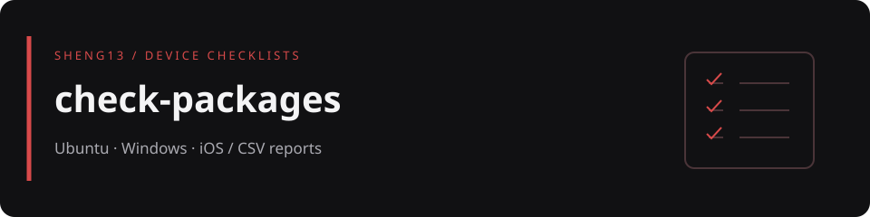

# check-packages

Ubuntu／Debian、Windows 與 iPhone／iPad 的軟體檢查工具集。桌面版查詢套件或命令是否存在，iOS 版提供人工確認表單；各版都能匯出可用 Excel 開啟的 CSV。

> 程式目前全部收在 ZIP 內，並未展開成根目錄原始碼。這是檢查與匯出工具，不會替你自動安裝或移除軟體。

[選擇平台](#platforms) · [開始使用](#usage) · [檔案地圖](#map) · [限制與資料安全](#safety)

<a id="platforms"></a>
## 選擇平台

| 平台 | ZIP 內的入口 | 檢查方式與輸出 |
|---|---|---|
| Ubuntu／Debian | `customer_checker_all/ubuntu/check_packages.py` | 使用 `dpkg-query` 與命令路徑檢查；可選預設清單或自行輸入，輸出狀態、依據與建議套件 |
| Windows 10／11 | `customer_checker_all/windows/run_windows_checker.bat` | 啟動 PowerShell 腳本，查詢解除安裝登錄資訊、命令與 Windows 功能，輸出 CSV |
| iPhone／iPad | `customer_checker_all/ios/ios_device_app_checker.html` | 顯示瀏覽器公開的裝置資訊，人工選擇 App 的 `install`／`uninstall` 狀態並匯出 CSV |

`install` 代表檢查到可用項目，`uninstall` 代表未檢查到；這兩個值不是安裝或解除安裝指令。

<a id="usage"></a>
## 開始使用

1. 下載 [原始工具包](customer_checker_all_platforms%20%281%29.zip)。
2. 先閱讀腳本，再將 ZIP 解壓縮到專用資料夾；不要覆蓋既有報表。
3. 依作業系統選擇下列入口。完整原始說明位於壓縮檔內的 `customer_checker_all/README.txt`。

### Ubuntu／Debian

需要 Python 3 與系統的 `dpkg-query`；腳本只使用 Python 標準函式庫，沒有額外的 pip 相依套件。

在解壓縮後的 `customer_checker_all` 目錄執行：

```bash
cd ubuntu
python3 check_packages.py
```

依提示選擇清單與輸出檔名，預設為執行目錄下的 `package_status.csv`。腳本可能列出建議的 `sudo apt ...` 指令，但不會執行，請先確認是否真的需要安裝那些服務。

| 結束碼 | 意義 |
|---|---|
| `0` | 全部項目已安裝，或存在可用的替代命令 |
| `1` | 存在未檢查到的項目，仍會輸出報表 |
| `2` | 系統條件、輸入或檔案寫入錯誤 |
| `130` | 使用者以 `Ctrl+C` 中斷 |

### Windows

在解壓縮後的 `windows` 資料夾雙擊 `run_windows_checker.bat`，並保留同目錄的 `check_windows_apps.ps1`。選擇預設或自訂清單，再輸入 CSV 檔名；預設輸出為腳本目錄下的 `windows_package_status.csv`，並包含電腦名稱與檢查時間。

啟動器使用 `powershell.exe -NoProfile -ExecutionPolicy Bypass`。執行前先審閱原始碼；若組織政策不允許，請交由管理員評估，不要自行放寬系統政策。部分 Windows 功能查詢可能受權限限制，未檢查到不等於一定沒有安裝。

### iPhone／iPad

使用可執行本機 HTML 的瀏覽器／預覽工具開啟 `ios_device_app_checker.html`，或放在受信任的內部網站後以 Safari 開啟。輸入 App 名稱、人工確認狀態，再匯出 `ios_device_info.csv` 或 `ios_app_status.csv`。

iOS 網頁不能列出全部已安裝 App。表單使用瀏覽器 `localStorage` 保留檢查項目；共用裝置操作完畢後，請依資料保留政策清理表單與下載報表。

<a id="map"></a>
## 檔案地圖

```text
.
├── README.md
├── docs/readme-banner.svg                 設計橫幅，非操作截圖
└── customer_checker_all_platforms (1).zip
    └── customer_checker_all/              以下為 ZIP 內的路徑
        ├── README.txt
        ├── ubuntu/check_packages.py
        ├── windows/run_windows_checker.bat
        ├── windows/check_windows_apps.ps1
        └── ios/ios_device_app_checker.html
```

<a id="safety"></a>
## 限制與資料安全

- 在他人裝置上執行前，先取得授權並遵守資訊安全政策。
- 查到命令或套件，只表示符合檢查規則；不代表服務已啟動、設定正確或沒有漏洞，也不能取代完整軟體資產盤點。
- CSV 可能包含裝置資訊、軟體清單與備註。不要加入密碼、Token、個人或客戶資料，也不要將真實報表提交到 Git。
- 使用者輸入的報表檔名可能指向既有檔案；匯出前確認目的地與覆寫風險。
- 本頁依 ZIP 內的 README 與原始碼整理，未執行各平台工具，不代表跨平台實測通過。
